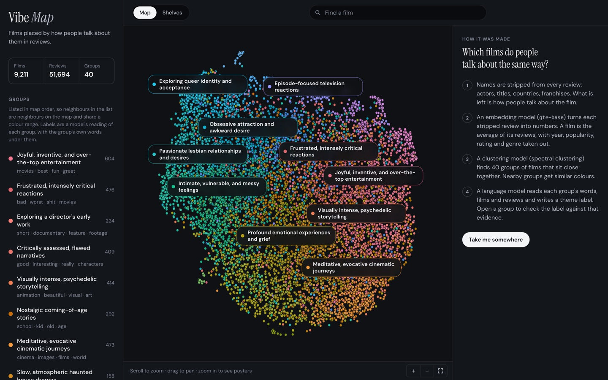
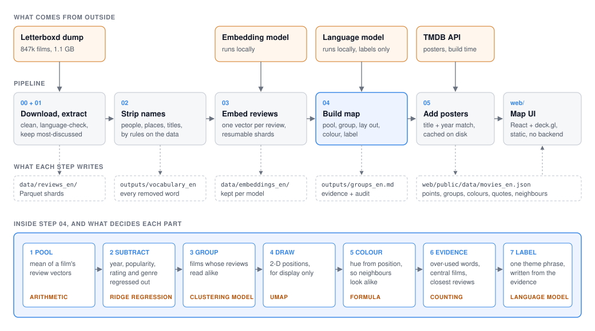

# Letterboxd Vibes

Which films do people talk about the same way?

This project reads Letterboxd reviews of 9,211 films, removes the names from them (actors, titles, countries, franchises), and groups the films by what is left: how people talk about them. Films end up together because their reviewers sound alike, whatever the genre, country or decade.



It is not a recommender and nothing in it is ranked. The groups are found by a clustering model, not defined in advance, and each group's theme label ("Slow, atmospheric haunted house dramas", "Existential loneliness and fading memories") is a language model's reading of the evidence shown next to it. [Who decides what](#who-decides-what) lists every choice a person did make.

## Why remove the names

An embedding model given a raw review mostly notices who and what it mentions. Cluster the films on raw reviews and the groups are a database: Disney, Batman, Godzilla, Bollywood, Kurosawa, the Beatles, Clint Eastwood, Christmas (the full list is under [What did not work](#what-did-not-work)). None of that needs reviews; it is already in the metadata.

So the reviews are stripped before the model sees them. No word list is written by hand. Three rules, each read off the data, decide what goes:

| Rule | A word is removed when | Catches |
|---|---|---|
| Rare | reviews of fewer than 20 films use it | character names, typos, in-jokes |
| Capitalised | across all reviews it is written with a capital more often than not, away from the start of a sentence | people, places, nationalities, brands, franchises |
| Credits | it is in the title, directors or first 20 cast of the film being reviewed (that film's reviews only, everyday words excepted) | the names people write in lower case |

On this corpus that removes 728 capitalised words and 67,409 rare ones, keeps a shared vocabulary of 7,383 words, and leaves 88% of the running text in place:

> "just found out that leonardo dicaprio, brad pitt, matt damon and ryan phillippe turned down roles for jack and ennis."
> becomes "just found out that leonardo,, and turned down roles for and."
>
> "they have ethan hawke sitting there shirtless with a belt in hand and i'm supposed to be scared?"
> becomes "they have sitting there shirtless with a belt in hand and i'm supposed to be scared?"

The first example shows the limit: "leonardo" survives because people rarely capitalise it and DiCaprio is not in *Brokeback Mountain*. The rules are leaky by design; the alternative is a hand-kept block list.

## How it works



1. **Extract.** One streaming pass over a [Hugging Face dump](https://huggingface.co/datasets/PratikDhonde/letterboxd-all-movie-data) of 847,209 films. Each review is cleaned and language-checked with fastText. 168,284 films have at least three usable English reviews; a bounded heap keeps the 10,000 most-discussed.
2. **Strip names.** The three rules above; `outputs/vocabulary_en.json` lists what was removed. Reviews left with fewer than 12 words are dropped, because [one-liners say little about the film](#short-reviews), and so are films left with fewer than three reviews. That leaves 9,211 films and 51,694 reviews.
3. **Embed.** Every stripped review becomes a 768-dimensional vector with [gte-base](https://huggingface.co/thenlper/gte-base), run locally. It was the best of six models in the [benchmark below](#choosing-the-embedding-model).
4. **Pool and subtract.** A film's vector is the mean of its review vectors. Release year, popularity, rating and genre, all columns of the dataset, are regressed out of it, so the groups cannot simply be eras, hits or genre shelves.
5. **Group.** A clustering model sorts the films: spectral clustering on the films' nearest-neighbour graph, 40 groups. It was chosen from nine by a [benchmark](#choosing-the-clustering-model) with a rule fixed in advance.
6. **Draw and colour.** UMAP reduces the film vectors to two dimensions for the map; nothing is clustered in 2-D. Each group's colour is computed from where it sits on the map, so neighbouring groups shade into each other.
7. **Collect evidence.** For each group: the words its reviews over-use, the films nearest its centre, and the reviews closest to its centre.
8. **Label.** A small language model running locally is shown that evidence and asked for one short phrase in the style of the "Themes" on a Letterboxd film page: the mood paired with what the stories are about. The UI shows the evidence under every label.

## Who decides what

| Part | Decided by |
|---|---|
| Which reviews are English | fastText language-ID model |
| Which words are names | Three counting rules on the reviews and the dataset's credits |
| How similar two reviews are | The embedding model |
| Which films belong together | The clustering model |
| Where a film sits on the map | UMAP |
| A group's colour | A formula on its map position |
| A group's words, quotes and example films | Counting and nearest-neighbour lookups on the reviews |
| A group's theme label | A language model, from that evidence |

Two different models do two different jobs here. The embedding model turns text into numbers and cannot name anything. The language model writes labels and takes no part in deciding which films go together.

What a person chose, and where to change it:

| Choice | Value | Where |
|---|---|---|
| Films on the map | the 10,000 most-discussed with at least 3 usable reviews | `config/base.yaml` |
| Name-stripping thresholds | 20 films; capitalised more than half the time; first 20 cast; everyday = used for over 10% of films | `config/base.yaml` |
| Shortest review kept | 12 words after stripping | `config/base.yaml` |
| Candidate embedding models, and the input prefix each one's documentation asks for | six models | `config/models.yaml` |
| Metadata removed | year, popularity, rating, genre | `config/base.yaml` |
| Number of groups | 40 | `config/base.yaml` |
| Rule for picking the embedding model | highest split-half agreement with genre regressed out | `scripts/benchmark_embeddings.py` |
| Rule for picking the clustering model | most stable among methods leaving at most 10% unassigned and at most 20% in one group | `scripts/benchmark_clustering.py` |
| The prompt given to the naming model | one prompt, the same for every group, with seven of Letterboxd's own theme labels as examples of the style | `naming.py` |
| Layout and colour constants | UMAP neighbours and spread; lightness and chroma | `config/base.yaml`, `colours.py` |
| Word filtering for the evidence | scikit-learn's English stop words; words in over 15% of reviews | `describe.py` |

There are no hand-written categories, anchor sentences, block lists or labelled films anywhere in the method. The naming prompt is the one place where a person tells a model what to write.

## Choosing the embedding model

With no labels, how do you score an embedding model on this task? The check used here is split-half agreement (`reliability.py`): split each film's reviews into two random halves, average each half, and ask whether a film's two halves are closer to each other than to other films. If different reviewers of the same film do not agree once the names are gone, there is nothing to cluster.

`scripts/benchmark_embeddings.py` runs it for six models on the stripped reviews of the same 1,500 films. Models are ranked on agreement after the dataset's genre labels are regressed out of the vectors, because the map removes genre too and a model should not win by being good at telling genres apart.

| Model | Dimensions | Agreement, genre removed | Agreement | Own half in top 10 | Reviews / s |
|---|---|---|---|---|---|
| **gte-base** (in use) | 768 | 0.876 | 0.906 | 38.3% | 55 |
| e5-base-v2 | 768 | 0.868 | 0.902 | 36.1% | 49 |
| Qwen3-Embedding-0.6B | 1024 | 0.854 | 0.906 | 40.4% | 9 |
| bge-base-en-v1.5 | 768 | 0.850 | 0.903 | 35.8% | 52 |
| EmbeddingGemma 2 | 768 | 0.832 | 0.878 | 29.9% | 18 |
| all-MiniLM-L6-v2 | 384 | 0.831 | 0.881 | 33.7% | 345 |

gte-base ranks first and is the model the map uses. Qwen3-Embedding-0.6B has the best top-10 rate before genre is removed, but it leans on genre more than the others: with genre out it drops to third, and it is six times slower. The top three are close (0.876, 0.868, 0.854 on a 1,500-film sample). The gap to the bottom two is not: EmbeddingGemma 2, the model this project was first built on, finishes level with all-MiniLM-L6-v2, a model a tenth of its size.

The measure has a blind spot worth stating: it rewards consistency, and a model could be consistent about the wrong thing. Removing names and genre before scoring is what keeps that in check.

## Choosing the clustering model

`scripts/benchmark_clustering.py` runs nine algorithms on the film vectors and measures each the same way: three standard separation scores, stability (agreement between runs on different 80% samples of the films), the share of films left unassigned, the size of the largest group, and how strongly the groups track genre.

The rule, fixed before looking at any groups: discard methods that leave more than 10% of films unassigned or put more than 20% in one group, then take the most stable.

At 40 groups:

| Method | Silhouette | Davies-Bouldin | Calinski-Harabasz | Stability | Unassigned | Largest group |
|---|---|---|---|---|---|---|
| k-means | 0.023 | 5.19 | 35 | 0.21 | 0% | 3% |
| Ward linkage | -0.015 | 6.57 | 23 | 0.09 | 0% | 5% |
| Average linkage (not eligible, found 40 groups) | -0.012 | 5.7 | 19 | 0.19 | 0% | 21% |
| Gaussian mixture | 0.022 | 5.16 | 34 | 0.19 | 0% | 3% |
| BIRCH | -0.015 | 6.57 | 23 | 0.09 | 0% | 5% |
| **Spectral** (selected) | 0.014 | 4.67 | 31 | 0.43 | 0% | 7% |
| UMAP + k-means | 0.007 | 7.14 | 28 | 0.38 | 0% | 5% |
| UMAP + HDBSCAN (not eligible, found 3 groups) | -0.004 | 4.85 | 26 | 0.10 | 46% | 51% |
| Leiden | 0.011 | 5.5 | 28 | 0.38 | 0% | 5% |

Spectral clustering is the most stable eligible method at 20 and 40 groups (0.57 and 0.43). At 60, UMAP + k-means edges it (0.37 against 0.36). The methods that start from each film's nearest neighbours (spectral, Leiden, UMAP + k-means) are well ahead of the ones that work on raw distances: k-means has the best silhouette and half the stability. That fits the data. In 768 dimensions with no clear gaps, who a film's neighbours are is more trustworthy than how far it is from everything else. HDBSCAN is not eligible: it finds three groups and leaves 46% of the films out. The full table for 20, 40 and 60 groups is in [`outputs/benchmark_clustering_en.md`](outputs/benchmark_clustering_en.md).

The number of groups is the one thing here a person chose. Stability falls as it rises, so 40 is a trade between specific groups and repeatable ones.

## Results

From `outputs/audit_en.json`:

| | |
|---|---|
| Films on the map | 9,211 |
| Reviews embedded | 51,694 |
| Embedding model | gte-base |
| Split-half agreement, all films | 0.881 (0.5 = chance) |
| Clustering model | Spectral, 40 groups |
| Silhouette / Davies-Bouldin / Calinski-Harabasz | 0.014 / 4.67 / 31 |
| Stability | 0.43 |

| # | Theme label | Films | Words its reviews over-use | Nearest its centre |
|---|---|---|---|---|
| 1 | Joyful, inventive, and over-the-top entertainment | 604 | movies, best, fun, great | *Singin' in the Rain*, *Boys Go to Jupiter* |
| 2 | Frustrated, intensely critical reactions | 476 | bad, worst, shit, movies | *Two Distant Strangers*, *Playing It Cool* |
| 3 | Exploring a director's early work | 224 | short, documentary, feature, footage | *Judgement*, *Poison* |
| 4 | Critically assessed, flawed narratives | 409 | good, interesting, really, characters | *The Big Short*, *Role Play* |
| 5 | Visually intense, psychedelic storytelling | 414 | animation, beautiful, visual, art | *Son of the White Mare*, *Danger: Diabolik* |
| 6 | Nostalgic coming-of-age stories | 292 | school, kid, old, age | *The Party*, *Flight of the Navigator* |
| 7 | Meditative, evocative cinematic journeys | 473 | cinema, images, films, world | *Mothlight*, *The Fire Within: Requiem for Katia and Maurice Krafft* |
| 8 | Slow, atmospheric haunted house dramas | 158 | horror, creepy, atmosphere, ghost | *Dark Water*, *Alison's Birthday* |
| 9 | Complex characters and self-examination | 393 | man, life, actor, character | *The Beta Test*, *White Hunter, Black Heart* |
| 10 | Brutal depictions of suffering and trauma | 276 | violence, disturbing, horror, brutal | *Snowtown*, *Scum* |
| 11 | Critical examinations of power and control | 292 | political, war, propaganda, people | *October (Ten Days that Shook the World)*, *October 8* |
| 12 | Profound emotional experiences and grief | 305 | crying, cried, emotional, grief | *The Broken Circle Breakdown*, *Our Friend* |
| 13 | Faith, belief, and divine questioning | 57 | god, faith, church, religion | *God's Not Dead 2*, *Miracle* |
| 14 | Warm, gentle family moments and connections | 316 | love, beautiful, life, sweet | *Our Little Sister*, *The Company of Strangers* |
| 15 | Existential loneliness and fading memories | 308 | life, world, memories, death | *Maborosi*, *Last Life in the Universe* |
| 16 | Animal-centric, heartfelt connections and observations | 55 | dog, cat, animals, pet | *Gates of Heaven*, *The Call of the Wild* |
| 17 | Exploring racial dynamics and prejudice | 53 | racist, white, racism, black | *Not Without My Daughter*, *Serial (Bad) Weddings* |
| 18 | Obsessive fascination with predatory marine life | 19 | shark, underwater, sea, creature | *Jaws 3-D*, *The Shallows* |
| 19 | Disturbing family dynamics and childhood wounds | 237 | family, child, kids, parents | *The Curse of the Cat People*, *M.O.M. Mothers of Monsters* |
| 20 | Intimate, vulnerable, and messy feelings | 518 | don, know, want, hang thursday | *Sometimes, I Think About Dying*, *Taylor Tomlinson: Quarter-Life Crisis* |
| 21 | Celebratory female performances and fandom | 342 | woman, actress, girl, performance | *Taylor Tomlinson: Have It All*, *Pamela, A Love Story* |
| 22 | Violent acts and their consequences | 476 | kill, police, murder, fucking | *Incident*, *Clickbait* |
| 23 | Passionate lesbian relationships and desires | 362 | love, lesbian, romantic, girl | *Foxfire*, *The Vampire Lovers* |
| 24 | Female experiences and resistance | 156 | women, woman, feminist, trans | *Fat Girl*, *Charlie's Angels* |
| 25 | Obsessive attraction and awkward desire | 445 | guy, man, hot, literally | *Clark*, *Bleed for This* |
| 26 | Exploring queer identity and acceptance | 195 | gay, queer, lesbian, homophobic | *Jenny's Wedding*, *Edge of Seventeen* |
| 27 | Explorations of intense sexual desire | 175 | sex, horny, porn, erotic | *Antiporno*, *Variety* |
| 28 | Sleazy, stylish murder mysteries | 21 | giallo, mystery, genre, killer | *The Forbidden Photos of a Lady Above Suspicion*, *The Fifth Cord* |
| 29 | Sexy, gothic vampire obsessions | 37 | vampire, werewolf, horror, gothic | *Bloodsucking Bastards*, *Fright Night* |
| 30 | Musical performances and fandom enthusiasm | 134 | music, song, singing, dance | *Guys and Dolls*, *Cyrano* |
| 31 | Sharp, cynical comedic observations | 322 | funny, comedy, jokes, funniest | *Dave Chappelle: Sticks & Stones*, *Ricky Gervais: SuperNature* |
| 32 | Episode-focused television reactions | 145 | episode, series, season, television | *The Paley Center Salutes The Good Place*, *Gen V - Prime Premiere* |
| 33 | Vehicular obsession and high-speed pursuits | 27 | car, driver, driving, racing | *Grand Prix*, *Senna* |
| 34 | Gory 80s slasher fun | 45 | slasher, kills, killer, horror | *Madman*, *Final Exam* |
| 35 | Passionate tales of athletic devotion | 40 | sports, baseball, basketball, team | *The Pride of the Yankees*, *Hoosiers* |
| 36 | Brutal martial arts action dramas | 57 | martial arts, action, fight, kung | *Heroes of the East*, *Headshot* |
| 37 | Gory zombie mayhem and thrills | 19 | zombie, gore, dead, gory | *Doctor Butcher M.D.*, *World War Z* |
| 38 | Sequels and their echoes | 119 | sequel, original, franchise, good | *Poltergeist II: The Other Side*, *Creepshow 2* |
| 39 | Remakes, adaptations, and re-imaginings | 26 | remake, original, version, shot shot | *12 Angry Men*, *Let Me In* |
| 40 | Dark crime and neo-noir thrillers | 189 | thriller, noir, crime, action | *Ransom*, *Mute Witness* |

The separation scores are low, and that is the honest reading: ways of talking about films blend into each other, so the groups are a partition of a continuum, not islands. The full evidence for every group is in [`outputs/groups_en.md`](outputs/groups_en.md).

**Is it just metadata in disguise?** Cramér's V between group membership and each thing the map is not supposed to be about (0 = unrelated, 1 = identical):

| | Release decade | Primary genre | Rating | Popularity |
|---|---|---|---|---|
| As built | 0.11 | 0.12 | 0.17 | 0.10 |
| Names stripped, nothing regressed out | 0.16 | 0.27 | 0.31 | 0.14 |

Stripping names and regressing out metadata do different jobs. The first removes what the metadata does not record (who is in a film); the second removes what it does. Rating is the association that survives most, and it should: whether people liked a film is part of how they talk about it.

### Short reviews

The dump keeps each film's most-liked reviews, and on Letterboxd those are often one-line jokes. `scripts/check_review_length.py` measures what they are worth, holding the number of films (600) and reviews per film (4) fixed and changing only the minimum length:

| Reviews of at least | Films with enough such reviews | Agreement | Own half in top 10 |
|---|---|---|---|
| 4 words | 9,788 | 0.742 | 17.8% |
| 8 words | 9,512 | 0.752 | 20.6% |
| 12 words | 8,102 | 0.765 | 22.7% |
| 15 words | 6,662 | 0.800 | 28.7% |
| 20 words | 4,812 | 0.828 | 30.8% |
| 30 words | 2,911 | 0.856 | 36.1% |
| 50 words | 1,410 | 0.887 | 43.4% |

Agreement rises steadily with length. Four 50-word reviews place a film better than four 12-word ones by a wide margin. The cut-off of 12 words is a trade, not an optimum: 20 would be more reliable but would leave about half the films with too few reviews, including most of the best-known ones. (This table was measured on EmbeddingGemma 2 vectors, the last run that embedded reviews of every length.)

## What did not work

- **Embedding the reviews as written.** Forty groups on raw review vectors (EmbeddingGemma 2, Leiden) come out as: Disney and Pixar; Lindsay Lohan and Zac Efron; Clint Eastwood; Jackie Chan and Steven Seagal; Bergman and Herzog; Vincent Price; Adam Sandler; Woody Allen; Godzilla; Batman and the MCU; Godard and Varda; Bollywood; Kurosawa and Ozu; Pacino and De Niro; Christmas; Jake Gyllenhaal; giallo; David Lynch. Their association with decade, genre, rating and popularity is 0.22, 0.25, 0.30 and 0.16. Regressing out metadata lowers those numbers and leaves the groups about the same people, because an actor's name is not a column of the dataset.
- **The newest embedding model.** The project was built on EmbeddingGemma 2 first. On this task it finished fifth of six, level with a model a tenth its size, and it is three times slower than the winner.
- **Scoring emotions.** An earlier version fitted a probe on GoEmotions (Reddit comments labelled with 27 emotions) and grouped films by their emotion scores. The numbers were sound and the result was dull: thirty groups described as "admiration and gratitude" or "curiosity and confusion", most of them the reviewer's verdict in different words. Twenty-seven emotion words are too narrow a vocabulary for how people talk about films.
- **Hand-written moods.** The first version measured each film against anchor sentences written for 40 moods. It produced readable groups, but the categories were one person's opinion with a model attached.
- **Density clustering.** HDBSCAN finds three groups and leaves 46% of the films out. It needs islands and there are none.

## Run it

Requires Python 3.10+ and Node 18+. The first run downloads the dataset (1.1 GB), the embedding model (0.4 GB) and, for names, a 3 GB language model. The naming model runs through MLX and needs Apple Silicon; anywhere else, set `naming.model` to nothing in `config/base.yaml` and groups are labelled by their three most distinctive words.

```bash
python -m venv .venv && source .venv/bin/activate
make setup

make download            # the Letterboxd dump
make map                 # extract, strip names, embed, build
make web                 # http://localhost:5173
```

Embedding is the slow step: about 55 reviews a second on an M4 laptop, so roughly 15 minutes. It writes one shard at a time and skips finished shards, so it can be stopped and resumed.

```bash
make benchmark-embeddings   # the embedding-model table above
make benchmark-clustering   # the clustering-model table above
python scripts/check_review_length.py
make test
make lint
```

Posters come from TMDB. Put a token in `.env` (see `.env.example`) and run `make posters`; lookups are cached and the key never reaches the browser. Without it the UI falls back to the poster URLs in the dataset, about a third of which no longer resolve.

## Layout

```
config/                  pipeline settings and the embedding-model registry
scripts/                 the pipeline, one script per step (00 to 05), two benchmarks and one check
src/letterboxd_vibes/
  text.py, lang_id.py    cleaning and language ID
  masking.py             the three name-stripping rules
  embedding.py           local embedding models
  films.py, vectors.py   reviews -> film vector
  deconfound.py          metadata regression
  reliability.py         split-half agreement
  clustering.py          clustering algorithms, stability, layout, neighbours
  describe.py            distinctive words, quotes
  naming.py              the labelling prompt and model
  colours.py             similarity colours
  audit.py               separation and metadata association
  export.py, tmdb.py     web JSON, group sheet, posters
tests/
web/                     React + deck.gl map, reads one JSON file
docs/                    architecture diagram, screenshot
outputs/                 benchmark tables, audit numbers, removed vocabulary, the group sheet
```

## Limits

- **Thin evidence per film.** The dump holds at most ten reviews per film, and after the length cut a film has five or six on average. Split-half agreement is well above chance but far from 1: a film's position is a noisy estimate. The films nearest a group's centre fit its name well; a famous film whose surviving reviews are jokes can land somewhere odd. More reviews per film is the one thing that would most improve this map.
- **Labels are a reading.** The naming model sees twelve film titles, eight reviews and a handful of words. It can overreach, and it knows films from its own training, so a label can say more than the reviews do. It is also a small model: some labels are stiff, and groups that are really about how people review (angry pans, jokes) get labels that describe the reviews, not the films. The evidence is always shown beside each one.
- **Leaky name-stripping.** Names that people write in lower case and that are not in the film's own credits get through, as do two-letter names. So do Letterboxd memes: one group's top words include "free thursday", from a joke people paste under many films ("if you read this I'm free on Thursday").
- **Topics are still there.** Stripping names does not strip subjects. Some groups are about what films contain (sharks, food, sport) more than how they feel. Genre is regressed out, but a subject is not a genre label.
- **Unfiltered language.** The words and quotes shown for a group are whatever its reviews contain, including swearing.
- **Soft groups.** Stability is 0.43 on a scale where 1.0 means identical groups on every resample. Films near a boundary can move.
- **One audience.** Letterboxd skews young, English-speaking and cinephile. The map shows how that audience talks.

## Data and credits

Reviews: [PratikDhonde/letterboxd-all-movie-data](https://huggingface.co/datasets/PratikDhonde/letterboxd-all-movie-data) (MIT). Embeddings: [gte-base](https://huggingface.co/thenlper/gte-base) (MIT). Names: [Gemma 3 4B](https://huggingface.co/mlx-community/gemma-3-4b-it-qat-4bit). Posters: TMDB. This product uses the TMDB API but is not endorsed or certified by TMDB.

The idea of stripping names out of reviews before embedding them comes from a video by flickmike about building the Flick app.
